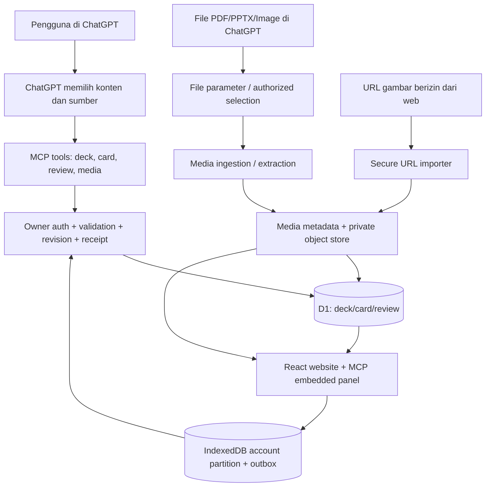

# NOODL FLASHCARDS — MASTER IMPLEMENTATION PLAN

> **Status: SPECIFICATION / PLANNING ONLY** — Dokumen ini bukan laporan pekerjaan yang sudah dilaksanakan. Belum ada repo GitHub baru, commit, deployment, migrasi database, atau perubahan pada repo sumber.
>
> **Versi:** 2.0 — 21 November 2026 (Asia/Jakarta)  
> **Nama kerja:** `noodl-flashcards` (bisa diganti)  
> **Basis:** `SeraKah-1/noodl-gpt` `main` @ `31e80e6cdf5484580dd18263ed5c2459dbb7eb28`  
> **Referensi desain:** `SeraKah-1/noodl` @ `ec8342b85213dd7c00b11f367298ee4df8ccb3b7`  
> **Pemilik keputusan:** pengguna proyek; perubahan ruang lingkup memerlukan pembaruan dokumen.

## 0. Keputusan arsitektur yang dikunci

1. **Produk baru dan repo baru, bukan fork yang terus mengikuti semua fitur upstream.** Salin dasar teknis `noodl-gpt` secara terkontrol; pertahankan atribusi/lisensi relevan. Jangan memodifikasi repo asal hanya untuk melakukan pivot.
2. **Satu domain fitur: flashcard.** Home, Library, Review, Settings adalah layar pendukung; tidak ada mode quiz, Brain Dump, Smart Sweep, simulator, comic, concept map, visual lab, atau Mix Room.
3. **ChatGPT adalah satu-satunya generator konten AI.** App tidak memanggil Gemini/OpenAI/Claude lewat API berbayar milik app atau pengguna. Tidak ada BYOK, prompt editor, pilihan model, atau pipeline generate internal.
4. **MCP adalah penghubung data, bukan model AI.** ChatGPT memilih isi, clue, sumber/gambar. Server MCP memvalidasi, menyimpan, membaca, dan memberikan hasil terstruktur; processing PDF/crop bersifat deterministik.
5. **Pertahankan jiwa visual Noodl:** violet, translucent/glass surface, typographic rhythm, maskot kaomoji, bottom navigation, micro-animation, gesture, sound/haptic yang bisa dimatikan. Jangan mempertahankan komponen usang hanya karena sudah ada.
6. **Swipe kiri/kanan harus berfungsi sebelum maupun sesudah kartu dibuka.** Pre-reveal swipe adalah self-report, bukan jawaban terverifikasi. Rating empat tingkat tetap ada.
7. **Clue timer default 20 detik** per kartu; clue tampil pada t=5, 10, 15 detik; timer berhenti pada t=20 tanpa auto-grade.
8. **Rich media asli, bukan URL tempelan sementara.** Card menyimpan `assetId`; server menyimpan metadata di D1 dan objek gambar di R2 atau storage privat setara. Web URL/embed mempunyai jalur dan kebijakan tersendiri.
9. **Sumber lokal diutamakan:** gambar asli PDF/slide sebelum gambar internet; jangan menukar diagram ilmiah yang labelnya penting tanpa konfirmasi eksplisit.
10. **V1 tidak mengimpor data lama secara diam-diam.** Repo/deployment/database baru terpisah. Migrasi data pengguna eksisting hanya pekerjaan terpisah dengan otorisasi dan pengujian.

## 1. Sumber, fakta repo, dan batas verifikasi

| Sumber | Telah terlihat di kode | Konsekuensi |
|---|---|---|
| [noodl](https://github.com/SeraKah-1/noodl) | `components/FlashcardScreen.tsx` membatasi `drag` ke `isFlipped`; sound/haptics di `hooks/useGameSound.ts`; visual lama memakai theme dan gesture | Ambil desain dan pola interaksi, **bukan** generator/quiz lama |
| [noodl-gpt](https://github.com/SeraKah-1/noodl-gpt) | `src/ui/FlashcardDeck.tsx` memakai `drag={flipped?...}` dan `rate()` menolak sebelum flipped | Aturan gestur dan penyimpanan rating harus diubah bersama |
| `noodl-gpt/src/client/bridge.ts` | `@modelcontextprotocol/ext-apps`, `callHost`, `sendChatRequest`; web standalone membuka ChatGPT + menyalin prompt | Website biasa bukan chatbot terselubung; panel ChatGPT lebih terintegrasi |
| `noodl-gpt/src/server/index.ts` | `/mcp`, tool descriptors, owner scope, revision, operation receipts, `ui://noodl/workspace` | Ambil server/bridge, kurangi tool dan perbarui schema |
| `noodl-gpt/src/shared/types.ts` | `Pack` + `Question` + `Attempt` + `ReviewEvent` | Perlu ganti domain menjadi `Deck` + `Flashcard` + `ReviewEvent` |
| `noodl-gpt/src/client/store.ts` | IndexedDB, partition akun, outbox, conflict handling | Pertahankan algoritma sinkronisasi, ganti tipe dan migrasi lokal |
| `.openai/hosting.json` | `d1: "DB"`, `r2: null`, existing project ID | Proyek baru perlu project, D1 dan R2/bucket sendiri |
| `noodl-gpt` CI | Runs untuk commit terinspeksi berhasil di GitHub Actions | Hanya bukti repo sumber; belum ada test repo pivot |

Perhitungan inventaris dasar: sekitar **109 file kode/tes/skrip** di `noodl-gpt` jika tidak menghitung dokumen, aset statis, skill vendored, dan lockfile. Di antaranya **43 file UI, 12 file server, 19 file tes**. Perubahan final tergantung dependency graph setelah pruning. Ketersediaan tool MCP pada deployment yang terhubung ChatGPT **tidak otomatis** mengikuti kode `main`; perlu uji host sebenarnya.

**Sumber eksternal yang perlu dicek lagi pada hari implementasi:**
- File inputs & widget file helpers: https://developers.openai.com/plugins/reference
- ChatGPT UI / MCP Apps: https://developers.openai.com/plugins/build/chatgpt-ui
- MCP Apps specification: https://apps.extensions.modelcontextprotocol.io/
- MCP protocol: https://modelcontextprotocol.io/

## 2. Scope produk: hapus / pertahankan / tambah

| Area | Perlakuan | Catatan |
|---|---|---|
| Standar, Batch, Survival, Time Rush quiz | **DELETE** | Hilangkan UI, session engine, API, types, tests, docs |
| Quiz question variants MCQ/TF/Fill Blank | **DELETE sebagai domain** | Flashcard tidak harus punya opsi jawaban |
| AI provider, model/key setup, prompt editor | **DELETE** | ChatGPT melalui MCP melakukan generasi konten |
| Brain Dump, concept diagnosis/repair, Smart Sweep, exam map | **DELETE** | Jangan tinggalkan handler tersembunyi |
| Comics, Visual Lab, concept graph/map, simulations, debugger | **DELETE** | Jangan copy CSS/assets yang tidak lagi dipakai |
| File-to-quiz import, quiz JSON import | **DELETE** | Ganti dengan image/source-to-flashcard via ChatGPT |
| Home, Library, Review, Settings | **KEEP + REBUILD CONTENT** | Ubah navigasi menjadi hanya 4 area |
| Classic theme, glass, maskot, animasi | **KEEP + REFINE** | Ambil dari Noodl asli dan Noodl-GPT |
| Offline IndexedDB + sync/outbox | **KEEP + ADAPT** | Akun terpisah, queued edits, revision checks |
| User preference, accessibility, i18n | **KEEP** | Sound, haptic, reduced motion, mode clue |
| SRS spaced repetition | **KEEP + REWRITE DOMAIN** | Review event berbasis card, bukan question |
| Flashcard flip, rating, swipe | **REFACTOR** | Swipe sebelum flip, Undo, pause, robust events |
| Timed clue dan session progress | **ADD** | t=5,10,15; default 20s; log behavior |
| Image/math/embed rendering | **ADD** | Blok konten terstruktur, aman |
| Media file flow, R2, web import, provenance | **ADD** | Metadata, thumbnail, import, deletion, ownership |
| MCP card/deck tools | **REPLACE/PRUNE** | Kurangi tool non-essensial |
| Public deck sharing | **P2 opsional** | Tidak wajib agar v1 berfungsi; privasi dulu |
| Manual editor lengkap | **P2 opsional** | V1 bisa mengedit lewat ChatGPT; minimal UI koreksi ringan boleh |

**Non-goals:** menambah AI SDK di backend, training model, server-side prompt orchestration, mengklaim penguasaan konsep tanpa tes objektif, scraping gambar bebas, menyimpan dokumen medis pengguna secara publik, mengeksekusi HTML dari model.

## 3. User journeys yang menjadi kontrak produk

### 3.1 Membuat deck berbasis teks di ChatGPT
1. Pengguna berkata: “Buatkan 15 flashcard tentang glomerulus, dengan clue bertahap.”
2. ChatGPT menyusun front/back, tiga clue per kartu, tag, dan judul deck; hanya mengklaim sumber jika benar-benar diperiksa.
3. MCP `prepare_deck_change` memvalidasi payload, jumlah kartu, panjang konten, dan menghasilkan preview tanpa menyimpan permanen.
4. Pengguna melihat ringkasan/kartu (atau ChatGPT mengonfirmasi maksud jika diperlukan).
5. MCP `commit_deck_change` menulis satu transaksi dengan idempotent receipt dan `deckId`; `open_deck` menampilkan UI.
6. Library, offline cache, dan `review` menggunakan record yang sama.

### 3.2 Membuat kartu dari PDF/slide dengan gambar asli
1. Pengguna melampirkan file ke ChatGPT atau memilih file melalui panel Noodl.
2. ChatGPT membaca materi yang memang tersedia pada percakapan, menunjuk **nomor halaman/slide, objek/area, dan tujuan belajar**.
3. Tool file-aware menerima referensi file terotorisasi; aplikasi memindahkan bytes ke ingestion boundary.
4. Pipeline melakukan preview halaman; jika perlu ambil **crop asli** dengan koordinat terukur. UI bisa meminta pengguna memilih area jika label/hasil rendering meragukan.
5. Final image disimpan sebagai `MediaAsset` privat. Sisi kartu menyimpan `assetId` dan referensi sumber.
6. ChatGPT membuat pertanyaan/jawaban/clue dari informasi yang memang ia lihat, bukan mengarang detail diagram.
7. Pengguna membuka deck; gambar tetap muncul setelah chat ditutup karena tersimpan di storage app.

### 3.3 Gambar dari internet
1. ChatGPT mencari kandidat gambar **bila browsing tersedia dan pengguna memang menginginkannya**.
2. Verifikasi relevansi serta penggunaan ulang: lisensi/izin, attribution, kualitas, dan keterbacaan label.
3. Tool `import_media_url` menguji keamanan URL dan mengambil konten yang diizinkan.
4. Simpan salinan privat hanya jika hak penggunaan cocok; jika tidak jelas, tampilkan rujukan sumber atau minta alternatif berlisensi.
5. Metadata sumber, attribution, retrieval date dan status lisensi disimpan bersama asset.

### 3.4 Gambar yang dihasilkan ChatGPT
1. ChatGPT membuat ilustrasi baru ketika host mendukung generasi gambar.
2. Hasil harus diekspos sebagai **file yang bisa dipindahkan** melalui file param/host file API. Tidak ada asumsi gambar yang muncul di chat otomatis dapat dibaca MCP.
3. Setelah diimpor, `assetId` dipasang ke kartu dan divalidasi melalui pembacaan ulang.
4. Jika host tidak memberi file transferable, fallback: unduh/unggah manual ke panel atau website.

### 3.5 Review tanpa membalik kartu
1. Front aktif, timer berjalan; swipe kiri atau kanan langsung mungkin dilakukan.
2. Sebelum revealed, kartu memperlihatkan cue “Belum tahu ← / Sudah tahu →”.
3. Swipe mencatat `answerRevealed=false`, `selfReported=true`, rating dan clue yang telah muncul.
4. Kartu berikutnya muncul setelah durable local save; server sync menyusul.
5. Undo mengoreksi aksi yang keliru, tanpa memalsukan event yang sudah tercatat.

## 4. Arsitektur runtime tujuan



- **Transport / identity:** pertahankan MCP server Worker dan trusted identity boundary di deployment yang memang memvalidasi user. Jangan mempercayai header `oai-authenticated-user-id` jika Worker bisa diakses langsung dengan header yang disuplai pengunjung.
- **Data:** D1 database baru untuk data privat dan metadata aset; R2/object store baru untuk byte gambar.
- **Client:** React + CSS/tokens untuk website dan panel ChatGPT (shared renderer), dengan IndexedDB untuk offline dan outbox.
- **MCP Apps:** UI lewat `ui://noodl-flashcards/workspace`, data tool tanpa UI kecuali `open_deck`/`open_library` atau tool render yang memang perlu.
- **Web standalone:** dapat membaca/mereview kartu; “Buat dengan ChatGPT” membuka ChatGPT dan menyalin konteks jika diperlukan. Jangan menjanjikan generasi inline secara otomatis tanpa AI backend.
- **Guest:** P0 boleh local-only; sebelum mendukung guest cloud perlu pemisahan cookie/owner seperti repo lama dan pengujian keamanan khusus. Pilih jalur paling kecil, bukan menggandakan auth stack.

## 5. Desain UI dan detail interaksi

### 5.1 Empat destination

| Layar | Isi utama | Tombol primer |
|---|---|---|
| Home | Deck terakhir, kartu jatuh tempo, CTA belajar, maskot dan petunjuk ringkas | “Review sekarang” / “Buat dengan ChatGPT” |
| Deck Library | Grid/list deck, jumlah kartu, tag, search, sort, duplicate, delete, deck detail | “Buka deck” |
| Review | Due queue, new cards, session progress, flashcard player, pilihan mode timer | “Mulai review” |
| Settings | Tema, bahasa, suara/getaran, reduce motion, clue/timer, akun, privasi, ekspor | “Simpan preferensi” |

### 5.2 Visual inheritance
- Ambil semantic tokens warna, typography, rounded surfaces, glass background, maskot dan bottom navigation dari Noodl; jangan hardcode warna berbeda pada tiap halaman.
- Prioritaskan satu kartu besar sebagai fokus layar; z-index overlay clue harus lebih rendah dari modal konfirmasi, lebih tinggi dari card background, tetapi tidak memblokir swipe.
- Front dan back memakai flip 3D jika motion boleh. Jika reduced motion aktif, ganti dengan crossfade tanpa rotasi.
- Desktop: kartu tidak terlalu lebar; tombol keyboard dan SRS terlihat. Mobile: kartu mengisi ruang aman, footer tidak menutupi tombol, swipe nyaman satu tangan.
- Komponen visual punya states: loading, empty, failed-media, upload pending, offline, saving, conflict, completed.
- Ikon dan warna tidak boleh menjadi satu-satunya indikator rating; ada label tekstual dan screen reader.

### 5.3 Gestur
- Kanan: `Mudah` / “Sudah tahu”. Kiri: `Lupa` / “Belum tahu”. Kedua arah selalu bisa digunakan, bahkan sebelum flip.
- Sebelum reveal, tampil teks penegas bahwa tindakan adalah penilaian diri; sesudah reveal, rating empat tombol: `Lupa`, `Sulit`, `Bagus`, `Mudah`.
- Drag hanya dipicu dari bidang kartu yang tidak interaktif; gambar yang di-zoom, video iframe, tombol, tautan, teks terpilih, form tidak mengaktifkan gesture rating.
- Threshold dari `src/shared/flashcardGesture.ts` digunakan sebagai titik awal (jarak/rasio kecepatan); uji di real touch device, jangan hanya turunkan threshold demi terasa responsif.
- Setelah rating, lakukan local atomic write; animasi transisi tidak boleh memunculkan duplicate `review_card` saat rapid double-swipe.
- Keyboard: `Space/Enter` flip, `ArrowLeft/ArrowRight` rating cepat sesuai keadaan, `1-4` ketika reveal, `Z` undo, `Esc` keluar. Shortcut tidak aktif saat fokus input/video/dialog.
- Tombol alternatif selalu tersedia: “Lewati” (`skip`, tidak SRS rating), “Balik”, “Undo”, empat rating. Hindari memaksa pengguna selalu swipe.

### 5.4 Undo dan pencatatan
- Untuk event review yang baru tersimpan lokal dan belum sync, undo boleh membatalkan operasi yang belum terkirim lewat mekanisme outbox terkontrol.
- Untuk review yang sudah di-ack server, jangan mengedit sejarah diam-diam; simpan compensating reversal/tombstone event dengan `revertsEventId`, lalu hitung SRS dari active events.
- Undo maksimal satu tindakan terakhir di v1 dan harus tetap konsisten saat refresh/reconnect; jika belum dapat diuji, nonaktifkan Undo lintas sesi dan nyatakan batasnya.

## 6. Spesifikasi timer dan clue: state machine

### 6.1 Aturan standar
- `timerSeconds=20` default; pilihan 10/20/30/off direncanakan sebagai konfigurasi deck/per-user. Jangan memaksa clue 15s pada timer 10s: skala clue secara eksplisit atau nonaktifkan schedule yang tak muat.
- Default clues adalah tiga elemen terurut: `{atSecond:5}`, `{atSecond:10}`, `{atSecond:15}`. Clue optional untuk kartu tanpa petunjuk; UI tidak membuat isi fiktif.
- Pada t=0 kartu terlihat dan timer mulai.
- t=5,10,15: satu toast pendek (misalnya 1.5–2.5s; implementasi diuji agar readable) dan masuk ke daftar clue yang dapat dibuka lagi.
- t=20: status `timed_out`, timer berhenti. **Tidak otomatis gagal, flip, atau swipe.** Pengguna memilih tindakan.
- Ketika flip pertama kali terjadi: timer berhenti dan `answerRevealed=true`; tidak ada clue baru lagi. Jika kembali ke front, timer tetap berhenti untuk kartu itu.
- Saat tab hidden, app suspended, modal blocking, fullscreen file picker, atau media masih pada tahap blocking load: timer pause; resume dari elapsed aktif, bukan wall-clock yang lewat saat hidden.
- Pada swipe/Next: batalkan toast, interval dan event listeners lama, mulai timer baru **setelah** kartu berikutnya aktif. Tidak ada clue milik kartu sebelumnya yang bocor.
- Manual “Lihat clue” boleh tersedia, dicatat sebagai clue dilihat secara manual; tidak menggeser waktu clue otomatis.

### 6.2 Implementasi jam yang tepat
- Jangan bergantung pada `setInterval` sebagai sumber kebenaran; gunakan akumulasi durasi aktif berbasis jam monotonic `performance.now()` ketika visible, dan satu tick UI untuk render detik.
- Jalankan logika kemunculan clue berdasarkan crossing threshold dari elapsed lama ke baru, bukan `elapsed===5`, agar event tidak hilang saat frame lambat.
- Saat kembali dari hidden, jangan langsung memunculkan tiga toast sekaligus. Jadwal waktu aktif tetap kontinu.
- Simpan `elapsedMs`, `cluesSeen`, `timerExpired`, `answerRevealed` pada ReviewEvent. Event penilaian dikomit sekali.
- Timer harus dapat dihentikan/dibersihkan pada unmount, pergantian cardId, mode repeat, dan dialog.

### 6.3 SRS
- Pertahankan SRS (spaced repetition: mengulang kartu pada interval yang disesuaikan performa), diproses dari review event.
- Rating 0–3 tetap pilihan pengguna; `selfReported=true` untuk pre-flip swipe, `answerRevealed=true` untuk rating setelah flip; keduanya bukan bukti jawaban tertulis benar. Jangan tampilkan mastery/accuracy objektif.
- Jangan otomatis mengurangi kualitas rating hanya karena clue sudah keluar, karena belum ada evidence validasi pembobotan. Tampilkan statistik clue usage terpisah.
- Event tetap immutable dan revision/idempotency dijaga. Reset history menghasilkan tombstone, bukan menghapus secara tersembunyi sehingga offline bisa memulihkan data lama.

## 7. Model data kanonis dan versi skema

Tujuan: satu format yang digunakan MCP, HTTP, IndexedDB, validator, exporter, renderer, dan unit tests. Definisikan `schemaVersion=1`. Jangan mencampur type `Question` lama dengan `Flashcard` baru pada storage permanen.

```ts
export type ContentBlock =
  | { type: 'text'; text: string; format?: 'plain' | 'markdown' }
  | { type: 'image'; assetId: string; alt: string; caption?: string; fit?: 'contain' | 'cover' }
  | { type: 'math'; latex: string; display?: boolean }
  | { type: 'embed'; provider: 'youtube' | 'vimeo'; url: string; title: string };

export interface SourceRef {
  kind: 'uploaded_file' | 'web' | 'generated' | 'author';
  title?: string;
  page?: number;  // 1-indexed for users
  slide?: number; // 1-indexed for users
  url?: string;
  inspected: boolean; // true only when source actually viewed/checked
  note?: string;
}

export interface Clue {
  id: string;
  atSecond: 5 | 10 | 15;
  text: string;
}

export interface Flashcard {
  id: string;
  front: ContentBlock[];       // non-empty
  back: ContentBlock[];        // non-empty
  clues: Clue[];               // 0..3, unique timestamps
  timerSeconds: 20;            // expand to 10|20|30|0 after UX approval
  tags: string[];
  sourceRefs: SourceRef[];
  createdAt: string;
  updatedAt: string;
}

export interface Deck {
  schemaVersion: 1;
  id: string;
  ownerId: string;
  revision: number;
  title: string;
  description: string;
  folder?: string;
  tags: string[];
  cards: Flashcard[];
  createdAt: string;
  updatedAt: string;
  deletedAt?: string;
}

export interface MediaAsset {
  id: string;
  ownerId: string;
  storageKey: string;
  mimeType: 'image/png' | 'image/jpeg' | 'image/webp';
  sizeBytes: number;
  width: number;
  height: number;
  checksumSha256: string;
  status: 'pending' | 'ready' | 'failed' | 'deleted';
  origin: 'upload' | 'pdf_crop' | 'pptx_render' | 'web' | 'chatgpt_generated';
  sourceRef?: SourceRef;
  creator?: string;
  attribution?: string;
  licenseName?: string;
  licenseUrl?: string;
  licenseStatus: 'verified' | 'unverified' | 'restricted' | 'not_applicable';
  createdAt: string;
}

export interface ReviewEvent {
  id: string;
  ownerId: string;
  deckId: string;
  cardId: string;
  rating: 0 | 1 | 2 | 3 | null; // null for skip or telemetry-only
  action: 'rate' | 'skip' | 'undo';
  revertsEventId?: string;
  answerRevealed: boolean;
  selfReported: boolean;
  cluesSeen: string[];
  elapsedMs: number;
  timedOut: boolean;
  reviewedAt: string;
}
```

**Penting:** TypeScript di atas adalah *kontrak target*, bukan hasil kompilasi. `timerSeconds` sengaja literal `20` dalam v1 MVP untuk memastikan clue schedule sederhana. Bila opsi timer dinamis aktif, validator dan UI harus diubah bersama. UUID, panjang string, domain embed, ukuran aset, dan jumlah kartu akan dibatasi di runtime menggunakan Zod/JSON Schema dan hard limits yang diuji. Konfigurasi batas konkret ditetapkan dalam kode agar bisa disesuaikan dengan hosting—jangan mengarang angka yang diklaim sebagai batas resmi.

### 7.1 Invariants yang harus divalidasi
- `front`, `back` masing-masing setidaknya satu blok yang bermakna; bukan array kosong atau whitespace.
- Setiap `assetId` ada, berstatus `ready`, dan milik owner yang sedang login (atau public asset resmi).
- `Clue` maks. tiga dan setiap `atSecond` unik. Clue tidak boleh bocorkan jawaban eksplisit jika tujuan latihan recall; review konten oleh ChatGPT dan pengguna, server hanya dapat melakukan pemeriksaan struktural.
- Semua URL embed berasal dari domain/video-ID yang di-allowlist, bukan HTML `iframe` mentah.
- Markdown dirender dengan sanitizer/komponen aman; dilarang arbitrary script/style atau `javascript:` URL.
- `sourceRefs.inspected=true` hanya jika proses benar-benar telah meninjau sumber; nomor slide/klaim sumber tidak otomatis menjadi verifikasi.
- Perubahan kartu tidak mengganti ID/revision untuk operasi update; sync reject update stale.

### 7.2 Skema database konseptual
- Pertahankan per-owner records + revision + operations dari `noodl-gpt` untuk deck dan review event jika struktur generiknya cukup; migrasi `record.kind='deck'` (bukan `pack`) dengan validasi yang eksplisit.
- Tambahkan `media_assets(id, owner_id, storage_key, status, mime, size, checksum, dimensions, origin, source_meta, created_at, deleted_at)`.
- Tambahkan `media_asset_refs(owner_id, asset_id, deck_id, card_id, side, block_index)` atau lakukan indeks referensi terkontrol agar deletion tidak menghapus gambar yang masih dipakai.
- Tambahkan `media_import_jobs(id, owner_id, operation_id, status, error, input_meta, output_asset_id, created_at)` jika import/extraction perlu berlangsung melalui job worker.
- Reuse `operations(owner_id, id, result)` untuk idempotency; retry operasi dengan ID sama hanya boleh untuk payload yang sama (tambahkan fingerprint request untuk menolak reuse ID berbeda payload).
- Private file URLs: gunakan route terautentikasi/protected short-lived signed URL; `storageKey` tidak boleh diekspos sebagai izin akses.

## 8. MCP contract baru

### 8.1 Public/model-visible tools (rancangan)

| Tool | Intent | Mutasi? | Input penting | Output |
|---|---|---:|---|---|
| `get_capabilities` | Kemampuan/limit | Tidak | - | Versi, format, fitur host |
| `list_decks` | Daftar deck | Tidak | query, cursor/limit | Ringkasan & ID |
| `get_deck` | Isi deck | Tidak | deckId, page | Kartu, revisi, jumlah |
| `prepare_deck_change` | Pratinjau create/append/update | Tidak | mode, deckId?, cards, revision? | Validation, preview token |
| `commit_deck_change` | Menyimpan hasil preview | Ya | prepareId, operationId | Receipt, deckId, revision |
| `update_card` | Edit satu kartu | Ya | cardId, deckId, revision, patch | Receipt, card/revision |
| `delete_card` | Hapus kartu | Ya | cardId, deckId, revision | Receipt/tombstone |
| `delete_deck` | Hapus satu deck | Ya | deckId, revision, operationId | Receipt/tombstone |
| `open_deck` | Buka panel flashcard | Tidak | deckId | Resource UI + ID |
| `list_due_cards` | Review due | Tidak | deckId?, pagination | Due cards + provenance |
| `record_review` | Simpan rating | Ya | cardId, event, operationId | Receipt |
| `get_progress` | Riwayat review | Tidak | deckId? | Count, due, review facts |
| `import_source_file` | Daftarkan file terotorisasi | Ya | file, purpose, operationId | fileAsset/job ID |
| `extract_source_media` | Rend/crop dari file/slide | Ya | sourceId, page/slide, box | preview/job/assetId |
| `upload_card_media` | Import gambar hasil ChatGPT | Ya | file, provenance, operationId | assetId |
| `import_media_url` | Import URL web berizin | Ya | URL, rights, attribution | assetId/rejection |
| `attach_card_media` | Pasang gambar ke card | Ya | deckId, cardId, side, assetId, revision | Receipt |
| `get_preferences`/`update_preferences` | Preference | Sesuai tool | Pengaturan | Preference/revision |

**Catatan:** daftar ini adalah rancangan awal. Untuk alat bantu UI embedded (`app_identity`, `app_snapshot`, `app_mutate`) gunakan scope `visibility: ["app"]`, tidak perlu mengotori konteks model. Pisahkan data mutation tools dari open-view tools: hanya `open_deck` atau `open_library` memberi resource UI.

### 8.2 Model-first workflow yang direkomendasikan
1. ChatGPT melihat `get_capabilities` bila belum tahu schema/limit.
2. Menyiapkan kartu dan clue; jika perlu file, import dulu dan terima `assetId`.
3. Memanggil `prepare_deck_change` untuk validasi atomik. Jangan membuat deck separuh jika kartu ke-9 gagal.
4. User dapat melihat ringkasan atau preview sesuai jenis aksi; konfirmasi eksplisit untuk delete/publish/overwrite.
5. `commit_deck_change` menyimpan, mengembalikan `operationId`, `deckId`, revision, count, dan failures jika ada; read-back `get_deck` untuk verifikasi.
6. `open_deck` hanya menavigasi setelah persist sukses.

### 8.3 Kontrak file OpenAI yang terverifikasi (bukan tebakan)
Dokumentasi ChatGPT menyediakan `_meta["openai/fileParams"]` untuk *top-level* file field. Schema file harus mendeklarasikan `download_url` + `file_id` sebagai required; `mime_type` + `file_name` declared optional. Contoh tool minimal:

```json
{
  "name": "upload_card_media",
  "description": "Import a user-authorized image into private Noodl media storage",
  "inputSchema": {
    "type": "object",
    "properties": {
      "file": {
        "type": "object",
        "properties": {
          "download_url": { "type": "string" },
          "file_id": { "type": "string" },
          "mime_type": { "type": "string" },
          "file_name": { "type": "string" }
        },
        "required": ["download_url", "file_id"],
        "additionalProperties": false
      },
      "operationId": { "type": "string" }
    },
    "required": ["file", "operationId"],
    "additionalProperties": false
  },
  "_meta": { "openai/fileParams": ["file"] }
}
```

Referensi resmi: https://developers.openai.com/plugins/reference .

**Implementasi repo asal yang harus diubah:** helper `tool()` pada `src/server/index.ts` saat ini mengisi `_meta.ui`; perlu mendukung penggabungan metadata OpenAI fileParams. Validator `validateArguments` yang sekarang sederhana harus menangani schema lengkap dengan benar (termasuk `$ref` bila digunakan), atau gunakan schema inline seperti di atas dan validasi mendalam. `download_url` bukan permanent URL; download -> validate -> store -> gunakan `assetId`.

### 8.4 ChatGPT widget APIs dan fallback
- Utamakan MCP Apps bridge (`@modelcontextprotocol/ext-apps`) untuk komunikasi standar.
- Jika tersedia, `window.openai.uploadFile(file,{ library?: true })` memberi `fileId`, `selectFiles()` memilih file yang diizinkan, `getFileDownloadUrl({fileId})` memberi URL sementara.
- Fitur-fitur ini **opsional** menurut host; feature-detect, jangan mengandalkan nama environment.
- Fallback browser: native file picker + server authenticated upload route, atau pengguna diminta memberi gambar langsung di panel.
- Tidak ada janji ChatGPT secara otomatis dapat membaca semua lampiran dari semua chat/proyek; transfer harus melewati jalur yang memang tersedia dan authorized.

## 9. Media ingestion, cropping, dan asal gambar

### 9.1 P0: upload gambar mandiri
1. File diterima melalui MCP file param / widget / browser input.
2. Server mengecek auth + owner + operationId, ukuran dan tipe berdasarkan *actual bytes*, bukan ekstensi/`mime_type` deklaratif semata.
3. Baca metadata ukuran/dimensi; batasi decompression/pixel bombs, image formats hanya PNG/JPEG/WebP di v1.
4. Re-encode/normalisasi bila perlu (menghapus metadata pribadi/EXIF secara default) dan hitung SHA-256.
5. Tulis ke R2; D1 mencatat asset `ready`; response mengembalikan `assetId`, width, height, source metadata.
6. Rend UI memakai URL yang diterbitkan oleh backend melalui owner-checked endpoint, bukan raw `file_id` ChatGPT.

### 9.2 P1: gambar dari PDF
- PDF sering mengandung diagram sebagai campuran vektor, teks, serta raster. **Mengekstrak embedded JPEG saja tidak cukup.**
- Tersedia dua jalur: (a) extract embedded image untuk gambar mandiri; (b) render halaman penuh lalu crop. Untuk card ilmiah, renderer halaman + crop biasanya mempertahankan label/anak panah lebih akurat.
- Pilih pipeline secara eksplisit sesuai hosting: browser-side PDF.js untuk preview/crop interaktif (membatasi ukuran; menghindari runtime native di Worker), atau isolated processing service/queue jika harus memproses file besar tanpa panel.
- Koordinat crop dinormalisasi 0..1 relatif terhadap halaman dan disimpan dengan page index 1-based untuk provenance. Preview bisa meminta koreksi manual.
- Jangan menganggap `page=3` yang dikirim model membuktikan halaman itu telah diekstrak; server harus menghasilkan file nyata dan user/tool memeriksa preview.
- Jika halaman terlalu rumit, tampilkan error atau simpan halaman utuh; jangan diam-diam membuat ulang diagram.

### 9.3 P1/P2: PPTX / PowerPoint
- PPTX ZIP memiliki `ppt/media` untuk image files, tetapi bentuk, shape, text box, vector chart dan relasi elemen bisa tersebar di XML slide. Ekstraksi `ppt/media` saja tidak mengembalikan tampilan slide yang utuh.
- Jalur penuh: render slide ke raster berkualitas cukup menggunakan pipeline yang benar-benar tersedia (mis. layanan rendering terpisah dengan LibreOffice, atau converter teruji), lalu crop dengan preview dan slide index; jangan menyatakan Workers dapat langsung menjalankan LibreOffice.
- Jalur ringan: extract embedded pictures saja ketika user meminta gambar asli yang memang ada dalam PPTX dan mapping slide relation valid.
- Jika renderer slide belum tersedia: dukung PDF hasil export sebagai fallback dan beri label batas kemampuan. Jangan menjual fitur PPTX penuh sebelum diuji.
- Validasi keamanan ZIP (zip bomb, XML berbahaya, ukuran entry total) dan file privacy/retention.

### 9.4 P2: gambar internet
- ChatGPT memilih kandidat via browsing (jika available). Back-end tidak perlu image crawler atau AI sendiri.
- Default sumber dengan lisensi/izin reuse yang terang: public-domain, CC sesuai syarat, dokumentasi resmi dengan izin penggunaan, atau aset pengguna. Public URL ≠ izin menyalin.
- `import_media_url` membatasi HTTPS, memblokir local/private IP, loopback, metadata IP, DNS rebinding, redirect tak aman, port/scheme tidak wajar, payload berlebihan, timeouts, decompression bomb, dan tipe file mencurigakan. Check redirect lagi setelah resolve; jangan membiarkan server sebagai proxy URL universal.
- Isi metadata: `sourceUrl`, `creator`, `licenseName`, `licenseUrl`, `attribution`, `retrievedAt`, `licenseStatus`, `contentHash`.
- Lisensi tak terbukti: **jangan otomatis menyalin**. Tawarkan sumber berizin lain atau tautkan ke situs sumber dengan ekspektasi broken links dan kebijakan provider.
- Jangan menganggap caption AI sudah mengonfirmasi bahwa gambar yang diunduh benar. Preview dan validasi hasil.

### 9.5 P2: gambar buatan ChatGPT
- Konten yang model hasilkan harus tersedia sebagai file nyata yang kompatibel dengan host file transfer. Jika tidak, fallback upload oleh pengguna.
- Tanda asal `chatgpt_generated`; tidak boleh diberi klaim berasal dari slide atau publikasi lain.
- Prompt kualitas: jika konten medis/sains, label harus diverifikasi terhadap sumber; ilustrasi generatif untuk diagnosis anatomi tidak boleh menggantikan diagram rujukan yang presisi tanpa tinjauan.

### 9.6 Embed
- V1 boleh mempertahankan image/text/math dahulu, YouTube/Vimeo embed sebagai P1 bila benar-benar diperlukan.
- Simpan `provider + videoId + URL canonical` setelah allowlist, bukan HTML embed mentah.
- Gunakan iframe sandbox minimum, `referrerPolicy`, content policy, placeholder offline, dan kontrol lazy loading; komponen iframe harus menghentikan propagation drag.
- Jika CSP ChatGPT host tidak mengizinkan domain itu, tampilkan tautan buka sumber; jangan longgarkan CSP dengan wildcard.

## 10. Asset storage, akses, lifecycle, dan biaya

### 10.1 Pembagian tanggung jawab
- **D1:** metadata `MediaAsset`, data card/deck, revisions, review events, operations.
- **R2/private object store:** bytes gambar, thumbnail/preview, cropped derivatives; file sumber disimpan sementara jika processing membutuhkan.
- **IndexedDB:** metadata deck/review dan thumbnail offline ukuran terbatas, **bukan** menyalin seluruh folder PDF untuk semua akun secara otomatis.
- **MCP file parameter:** jalur transport sementara. Jangan simpan temporary host URLs dalam data permanen.

### 10.2 Route/server internal (rancangan)
- `POST /api/media/upload` — browser direct upload terautentikasi; ukuran dibatasi.
- `POST /api/media/import-job` — submit deterministic crop/processing job bila perlu.
- `GET /api/media/:assetId` — auth/owner check, controlled caching dan content headers.
- `GET /api/media/:assetId/thumbnail` — thumbnail dengan scope sama.
- `DELETE /api/media/:assetId` — hanya bila tanpa referensi aktif atau soft-delete/cleanup.

MCP tools menggunakan **service yang sama** dengan route HTTP agar satu validator dan rule ownership berlaku di semua channel.

### 10.3 Lifecycle
1. Upload source -> pending asset dengan TTL.
2. Processing sukses -> ready final image + checksum + thumbnail.
3. Attach ke card -> tambah authorized reference.
4. Card/deck diedit -> update refs; tidak menghapus asset yang direferensi kartu lain.
5. Expired unattached -> GC/cleanup terjadwal, log minimal.
6. Delete deck -> tombstone data untuk sync, kemudian delayed deletion bytes setelah aman; tidak membangkitkan asset lama lewat offline outbox.
7. Export workspace/deck -> hanya manifest + image bundle atas permintaan jelas; perlu versi format dan batas ukuran.

**Biaya:** R2 menambah biaya storage, operasi, serta kemungkinan pemrosesan konversi. Tidak ada estimasi rupiah sebelum ukuran file rata-rata, volume deck, retensi, dan paket hosting nyata diketahui. Pasang kuota default yang eksplisit, observability per owner, dan pembersihan orphan untuk menghindari storage tumbuh tanpa batas.

## 11. Keamanan, privasi, dan otorisasi

- **Trust boundary:** user identity dari host yang terpercaya. Jangan pernah membuka Worker yang menganggap header bebas dari browser sebagai bukti login.
- Semua query untuk deck/card/review/media harus `owner_id` scoped. Test cross-account/IDOR, including media asset and preview job.
- Semua mutasi memakai `operationId` idempotent, `expectedRevision`, dan concurrent-guard; `operationId` reuse dengan payload berbeda ditolak.
- Endpoint URL downloader harus tahan SSRF, redirects, DNS rebinding, metadata IP, data exfiltration, content spoofing, decompression bombs, malicious SVG/PDF/PPTX.
- PII/confidential diagrams dari file/slide tidak dipublikasikan; default private. EXIF dihapus kecuali dipilih berbeda dan diperlukan.
- Embed dan Markdown sanitize; tidak ada custom HTML/eval/model-produced script di flashcard.
- Web content eksternal adalah data tak tepercaya; teks “instruksi” di PDF/website tidak boleh mengubah hak akses MCP atau menyuruh publish/delete data.
- CSP hanya resource/media/provider yang dibutuhkan; test iframe restrictions dalam host ChatGPT.
- Permission public sharing akan menjadi fitur terpisah dengan per-deck consent, attribution/copyright, warning konten sensitif, dan tidak mengekspos review history.
- Audit data minimization: simpan file sumber asli hanya jika perlu; tentukan retention pending uploads; jangan log temporary download URLs atau seluruh isi file di server log.
- Logout/tukar akun: bersihkan in-memory cache dan cegah asset owner sebelumnya tampil. IndexedDB per-user bukan enkripsi disk; dokumentasi harus jujur.

## 12. Pruning yang ditargetkan ke file nyata

> Target file berikut adalah hasil inventaris yang diperiksa, bukan instruksi menghapus semuanya tanpa dependency check. Tentukan keep/rewrite/delete dengan `rg`/import graph dan `git status` saat implementasi.

### A. Kemungkinan DELETE dari `noodl-gpt`
- `src/ui/BatchQuiz.tsx`, `src/ui/SmartSweep.tsx`, `src/ui/SmartSweep.css`.
- `src/ui/Comic.tsx`, `src/ui/Comic.css`, `src/ui/ConceptMapView.tsx`, `src/ui/DebuggerStudio.tsx`, `src/ui/DebuggerStudio.css`, `src/ui/GastricDebugger.tsx`, `src/ui/SimulationRunner.tsx`.
- `src/ui/Tools.tsx`, `src/ui/Tools.css`, `src/ui/StudyPlanning.tsx`, `src/ui/classic/StudyOptions.tsx`, `src/ui/classic/ToolPicker.tsx` (kecuali ada utilitas universal yang terlebih dahulu dipindahkan).
- `src/server/brainDump.ts`, `src/server/debugger.ts`, `src/server/recallRepair.ts`, `src/server/sweep.ts`.
- `src/shared/batch.ts`, `src/shared/comic.ts`, `src/shared/conceptGraph.ts`, `src/shared/conceptMap.ts`, `src/shared/debugger.ts`, `src/shared/examCoverage.ts`, `src/shared/practice.ts`, `src/shared/quickSession.ts`, `src/shared/repairWorkflow.ts`, `src/shared/simulation.ts`, `src/shared/studyContext.ts`, `src/shared/studyPlans.ts`, `src/shared/nextStep.ts` **setelah** pemanggilannya tidak ada.
- Quiz-focused tests/scripts seperti `tests/comic.test.ts`, `tests/debugger.test.ts`, `tests/exam-coverage.test.ts`, `tests/quick-session.test.ts`, `scripts/smoke-comic.mjs`, `scripts/smoke-debugger.mjs`, `scripts/smoke-sweep.mjs`; tes API auth/storage yang masih relevan dipindahkan/ditulis ulang, bukan dihapus tanpa pengganti.
- Artefak PDF export khusus quiz termasuk `src/server/exportFont.ts` ~1.14 MB source jika tidak lagi dibutuhkan; pertahankan kebutuhan ekspor terlebih dahulu bila ingin PDF deck export di P2.
- Docs dan vendored skill desain/fitur yang tidak lagi diperlukan; evaluasi ulang license attribution untuk code/aset yang tetap dipakai.

### B. REWRITE / ADAPT
- `src/App.tsx`: hilangkan state/router/handler quiz; jadikan home/library/review/settings shell.
- `src/ui/FlashcardDeck.tsx`, `.css`: gestur pre-flip, Undo, clue/timer, media renderer, robust local persist.
- `src/ui/Study.tsx`, `src/ui/Study.css`: ekstrak hanya komponen flashcard atau hapus study engine; jangan biarkan quiz session terselip.
- `src/ui/classic/Home.tsx`, `src/ui/classic/Navigation.tsx`, `src/ui/classic/Classic.css`: empat destinations dan CTA ChatGPT.
- `src/ui/PackDetail.tsx`, `src/ui/LibraryCard.tsx`, `src/ui/BankEditor.tsx`: rename/rebuild menjadi DeckDetail/DeckCard/minimal edit; tidak ada quiz options.
- `src/shared/types.ts`, `src/shared/validation.ts`, `src/shared/engine.ts`: card/deck/SRS domain. Buang MCQ correctness engine.
- `src/shared/flashcardGesture.ts`: update semantics, test false positives.
- `src/server/index.ts`, `src/server/control.ts`: minimal tool registry dan handlers; media integration.
- `src/client/index.ts`, `src/client/store.ts`, `src/client/bridge.ts`: deck sync, MCP host file capability, per-account media caching.
- `src/ui/theme.ts`, `src/ui/App.css`, `src/ui/NoodlV3.css`, `src/ui/StudyDesk.css`: prune dormant styles; pertahankan visual language.
- `tests/domain.test.ts`, `tests/server.test.ts`, `tests/offline.test.ts`, `tests/flashcard-gesture.test.ts`, `tests/review-queue.test.ts`: rewrite assertions ke deck/card.
- `.openai/hosting.json`, `plugin/plugin.json`, `plugin/.app.json`, `README.md`: proyek dan capability baru; jangan copy existing project ID/app binding untuk deployment baru.

### C. KEEP / REUSE AS NEEDED
- React, TypeScript, Vite, Framer Motion, CSS themes, KaTeX, lucide, PWA support bila teruji.
- MCP Apps bridge `@modelcontextprotocol/ext-apps`, server Worker bundling dan serving resource.
- LocalStore owner partitions, safe outbox, retry receipts, conflicts, tombstones, D1 access patterns.
- Preference/contrast/a11y tests yang tetap relevan, auth/guest tests, build verification framework.
- Original Noodl `hooks/useGameSound.ts` sebagai referensi suara & vibration, tetapi jangan copy modul tanpa memeriksa memory/event lifecycle.

## 13. Target struktur kode

```text
noodl-flashcards/
├── .github/workflows/ci.yml
├── .openai/hosting.json              # NEW project/bindings, not source identity
├── docs/
│   ├── MASTER_PLAN.md
│   ├── ARCHITECTURE.md
│   ├── MCP_CONTRACT.md
│   ├── MEDIA_PIPELINE.md
│   ├── SECURITY.md
│   ├── TESTING.md
│   ├── DEPLOYMENT.md
│   └── IMPLEMENTATION_LEDGER.md
├── migrations/
│   └── 0001_flashcards.sql
├── plugin/
│   ├── .app.json
│   └── plugin.json
├── public/                       # licensed brand assets
├── src/
│   ├── app/App.tsx
│   ├── app/Navigation.tsx
│   ├── client/bridge.ts
│   ├── client/client.ts
│   ├── client/store.ts
│   ├── components/Home.tsx
│   ├── components/DeckLibrary.tsx
│   ├── components/DeckDetail.tsx
│   ├── components/FlashcardDeck.tsx
│   ├── components/Flashcard.tsx
│   ├── components/ClueToast.tsx
│   ├── components/CardMedia.tsx
│   ├── components/ReviewSummary.tsx
│   ├── hooks/useFlashSwipe.ts
│   ├── hooks/useFlashcardTimer.ts
│   ├── server/index.ts
│   ├── server/mcpTools.ts
│   ├── server/decks.ts
│   ├── server/reviews.ts
│   ├── server/media.ts
│   ├── server/fileImport.ts
│   ├── server/auth.ts
│   ├── shared/types.ts
│   ├── shared/validation.ts
│   ├── shared/srs.ts
│   ├── shared/media.ts
│   └── styles/tokens.css
├── tests/
│   ├── mcp.test.ts
│   ├── schema.test.ts
│   ├── swipe.test.ts
│   ├── timer.test.ts
│   ├── srs.test.ts
│   ├── sync.test.ts
│   ├── media-security.test.ts
│   ├── file-import.test.ts
│   └── e2e/
├── package.json
└── README.md
```

Direktori ini *tujuan*, bukan keharusan rename besar sekaligus. Utamakan perubahan yang dapat direview dan diuji per PR.

## 14. Roadmap PR berurutan (dependensi + bukti selesai)

### PR-00 — Baseline & branch independent (P0)
- **Perubahan:** new repository, base dari snapshot `noodl-gpt`; LICENSE/NOTICE/README; konfigurasi CI branch protection; no production secrets. Pin deps, lockfile; baseline tests.
- **Acceptance:** repo baru punya histori/source jelas, CI terbuka, source repo tidak berubah, no copied production identity.
- **Risiko:** tanpa new Sites project, MCP belum hidup; tandai `source-only`.

### PR-01 — Navigation + dead feature pruning (P0)
- **Perubahan:** buang route/komponen quiz, Batch, Smart Sweep, comic, Brain Dump, visual tools, menu, CSS tidak dipakai; sementara sediakan static empty deck screen.
- **Acceptance:** `typecheck`, tests relevan, `build` PASS; empat layar tidak memiliki dead links; grep pada tool registry tidak menemukan tool quiz.

### PR-02 — Canonical Deck/Card model + local store (P0)
- **Perubahan:** types/validation, deck data, review events, schema version; IndexedDB partition; D1 migration; app/account behavior.
- **Acceptance:** create/load/update/delete deck local & server; conflict tests; fresh database migrations; per-owner isolation; no old `Question` in persistent deck schema.

### PR-03 — MCP deck CRUD + ChatGPT panel (P0)
- **Perubahan:** `prepare_deck_change`/`commit_deck_change`, browse/open/delete, receipts, bridge, app-only sync tools; focused tool descriptions.
- **Acceptance:** model dapat membuat deck teks, baca ulang, append tanpa duplikasi, menolak stale revision, membuka panel. Tes local tidak diklaim setara live ChatGPT.

### PR-04 — Flashcard UX core (P0)
- **Perubahan:** refactor Noodl card, pre-flip swipe, four ratings, skip, Undo, sound/haptic, keyboard, reduce motion.
- **Acceptance:** gesture tests, 0 unexpected double records pada rapid-swipe tests, refresh preserves review, no accidental swipe saat scrolling/media interaction.

### PR-05 — Timer + 3 clues (P0)
- **Perubahan:** hook timebase monotonic, pause/resume, toast/history, timeout, review metadata.
- **Acceptance:** fake-clock tests t=5/10/15/20; tab visibility, flip, swipe, unmount, media loading, reduced motion, simultaneous UI events.

### PR-06 — ImageBlock + R2 media core (P0)
- **Perubahan:** `MediaAsset`, D1 metadata, private R2 bucket, secured upload/download, thumbnails, media renderer, cleanup.
- **Acceptance:** reload cross-device still serves image; owner B cannot access owner A image; unreferenced cleanup not delete referenced asset; malicious MIME rejected.

### PR-07 — ChatGPT file transfer + PDF crop (P1, release gate for source-image promise)
- **Perubahan:** OpenAI fileParams schema, widget APIs feature detection, file download -> safe import, PDF render/crop preview, source references, fallback browser upload.
- **Acceptance:** user selects 1 PDF with diagram; ChatGPT links actual crop from page X, card renders after reopening, `sourceRef` matches actual source. Test on live connected host, not only mocked MCP.

### PR-08 — PPTX + richer sources (P1/P2)
- **Perubahan:** PPTX picture extraction with slide mapping, rendered slide crop when processing service available, unsupported fallback; web importer; ChatGPT-generated media transfer.
- **Acceptance:** image with text/arrow from slide preserved; web license policy; re-download stored asset after external source disappears; unsupported host gives honest fallback.

### PR-09 — Offline, backup & polish (P1)
- **Perubahan:** bounded asset offline cache, resume, error reconciliation, export/import deck with assets optional, typography/layout/a11y, optional first-run hints.
- **Acceptance:** card/text review offline then sync, no data cross-account, media availability state honest, export/import round-trip stays valid.

### PR-10 — Release hardening (P0 before public launch)
- **Perubahan:** security regression suite, e2e mobile/desktop, host/production smoke, deployment migration, docs, versioning/rollback plan, observability.
- **Acceptance:** semua release gates di Section 16 lulus dan bukti live ditulis di implementation ledger.

**Dependency rule:** PR-03 membutuhkan PR-02. PR-04 dan PR-05 membutuhkan card model. PR-07 membutuhkan PR-06. PR-08 jangan menghalangi peluncuran MVP teks + gambar upload + PDF jika hosting PPTX belum tersedia.

## 15. Level rilis yang tidak membingungkan

| Level | Apa yang sudah bisa dilakukan | Harus diuji live? |
|---|---|---|
| **M0 — Technical skeleton** | New repo, no quiz, 4 screens, empty decks | Tidak cukup untuk dipakai |
| **M1 — Text flashcards MVP** | ChatGPT membuat deck via MCP; review; swipe preflip; timer/clues; offline text | **Ya** untuk klaim ChatGPT linked |
| **M2 — Image flashcards** | Upload gambar dan PDF crop + permanent private assets; ChatGPT file transfer | **Ya** pada host dan real PDF |
| **M3 — Full rich media** | PPTX slide render, web licensed images, ChatGPT-generated visuals, embed, backup | **Ya** untuk setiap path |
| **M4 — Public ready** | Hardening, authorization, observability, perf and accessibility gates | **Ya** pada production |

Jika media dari ChatGPT host belum bisa ditransfer secara programatis, M1 tetap dirilis jujur sebagai **text-first**; M2 tidak diberi label selesai hingga ada end-to-end proof. Ini lebih baik daripada mengiklankan “AI image support” padahal hasil akhirnya cuma URL mati.

## 16. Test matrix dan release gates

| Kelompok | Skenario minimum | Mekanisme |
|---|---|---|
| Data schema | Empty blocks, invalid image ID, duplicate clue time, malformed embed, excessive payload | Unit/property tests |
| Deck MCP | Create/append/update/delete; same op retry; different payload same op ID; conflict across devices | Worker integration tests |
| Identity | Owner A/B separate decks, media, history, jobs; forged identity header; logout cache | Security integration + deployment auth tests |
| Swipe | Before reveal, after reveal, velocity/distance, diagonal scrolling, media controls, touch/keyboard | Unit + Playwright |
| Undo | Undo unsynced vs acked, same event twice, refresh between rating/Undo | Store + server tests |
| Timer | t=0/5/10/15/20, 20s expire, pause hidden, resume, flip, rapid next, long CPU jank | Fake monotonic clock + browser |
| Clue content | 0–3 clues, no answer leakage during obvious cases, historical clue view | Schema + content inspection |
| Media | Valid PNG/JPG/WebP, mislabeled MIME, huge image, EXIF, corrupt file, duplicate checksum | Import tests |
| PDF/PPTX | Embedded raster + vector labels, wrong slide/page, rotated document, failed render, oversized file | Fixtures + visual comparison |
| Web import | SSRF loopback/IPv6, redirect private IP, malicious SVG, DNS rebinding mock, huge download, license missing | Security tests |
| Hosting | MCP list/call, resource open, identity, D1+R2, download signed file TTL | Connected-host smoke |
| Offline | Shell/cached deck loads, review queue persists, reconnect replays once, media fallback | E2E with network throttle |
| UI accessibility | Focus, keyboard, screen reader statuses, touch targets, motion reduction, image alt | axe + manual assistive smoke |
| Performance | Long decks, 100+ cards, large thumbnails, drag at 60fps where supported, memory after many flips | Browser profile / budget gate |
| Regression | Deleted quiz tools/routes/style not reappear, package audit, npm CI | Static + CI |

### Definition of Done per PR
- Compiler/typecheck passes.
- Relevant unit + integration tests pass.
- Production build passes.
- Owner scopes/revisions/idempotency remain correct for changed writes.
- UI touched: mobile and desktop screenshot/interaction review; no simulated screenshot claims.
- Documentation and status ledger updated: `planned`, `source-implemented`, `tested-local`, `tested-live`, `released` are different states.
- Build proof tidak mengklaim deployment atau live ChatGPT plugin proof.

### Definition of Done public release
- Signed-in user creates 10 text cards with 3 clues each through actual connected ChatGPT MCP, stores and reopens after refresh/device change.
- 10-card review with 20s timer, all clue threshold, preflip swipe and Undo works without duplicate history.
- Images are private durable assets; unauthorized user cannot access them by guessing IDs.
- One actual PDF + page crop test succeeds; one unavailable/ambiguous diagram test fails honestly.
- Host file transfer checked on supported client; website standalone fallback documented.
- ChatGPT-connected tool version, host identity, D1/R2 status, and UI resource verified on deployed target.
- Zero relevant high/critical dependency vulnerabilities unless explicitly documented/exempted with justification.
- Privacy, account partition, offline, and data export/deletion behavior tested.

## 17. Risk register dan mitigasi

| Risiko | Dampak | Mitigasi utama | Gate |
|---|---|---|---|
| ChatGPT file param tidak tersedia di host tertentu | Tidak bisa attach dari chat secara langsung | Feature detect + file picker/upload fallback; live host test | PR-07 |
| Dokumen PPTX render hanya ekstrak `ppt/media` | Diagram hilang label/panah | Full-slide raster pipeline atau PDF export fallback | PR-08 |
| Web image berhak cipta atau link mati | Pelanggaran penggunaan / gambar hilang | Reusable licensing, source attribution, managed copy only where allowed | PR-08 |
| Worker dipercaya menerima forged identity headers | Data lintas akun terekspos | Trusted proxy + direct ingress deny/verify auth; tests | PR-00/10 |
| SSRF dari `import_media_url` | Akses internal atau data leak | URL fetch isolation, DNS/IP/redirect controls, strict limits | PR-08 |
| Rating preflip dianggap benar objektif | Statistik menyesatkan | `selfReported`, `answerRevealed`, no objective accuracy claims | PR-04 |
| Double-swipe/Undo ketika async save | History dan SRS rusak | atomic state + idempotent ops + compensating review events | PR-04 |
| Runtime PDF/PPTX terlalu berat untuk Worker | Import gagal atau biaya tinggi | Browser PDF preview + job service only if justified | PR-07/08 |
| Storage bertambah tanpa batas | Biaya tidak terkendali | thumbnails, retention, quotas, garbage collection, telemetry | PR-06 |
| CSS lama saling berbenturan setelah pruning | UI regresi | semantic tokens + prune unused selectors + screenshot tests | PR-01/09 |
| Active deployed MCP tertinggal dari `main` | Tool baru tak ada di ChatGPT | release ledger + connected-host tool discovery/readback | PR-10 |
| Migrasi data lama dipaksakan | Kehilangan history / cross-account | New fresh DB default; migration separate explicitly authorized project | Out of scope |

## 18. Estimasi effort (bukan janji jadwal)

Perkiraan berdasarkan inventaris, **belum hasil audit dependency graph lengkap**:
- **Dihapus:** sekitar 35–55 file/modul.
- **Direfaktor:** sekitar 20–30 file/modul.
- **Ditambahkan:** sekitar 10–18 file utama untuk flashcard core + kira-kira 5–10 modul tambahan jika gambar/PDF/PPTX/web ingestion dikerjakan penuh.
- **Total:** 65–103 perubahan tingkat file untuk core pivot; total bisa meningkat untuk media, tests, tooling, dan docs.

| Workstream | Relatif | Kenapa |
|---|---|---|
| Pemangkasan route/UI lama | Sedang–tinggi | Banyak import dan state di App, CSS, server tool registry |
| Canonical card/deck + sync | Tinggi | Menyentuh server, client, schema, offline, semua tools |
| MCP CRUD + auth | Sedang–tinggi | Revision, ownership, retries, ChatGPT compatibility |
| Swipe + animation | Rendah–sedang | Komponen ada tetapi guard aturan harus diganti |
| Timer + clue UI | Rendah–sedang | Scope jelas tetapi butuh clock dan visibility tests |
| R2 image storage | Tinggi | Auth, storage lifecycle, backups, CSP |
| ChatGPT file transfer | Tinggi/risky | Host-dependent; live verification wajib |
| PDF crop | Sedang–tinggi | Rendering/coordinate correct, safety, memory |
| Full PPTX render | Tinggi | Processing pipeline dan fidelity ilmiah |
| Web import+licensing | Tinggi | SSRF, image rights, provenance |
| Release/observability | Sedang–tinggi | New deployment & real-world host tests |

**Jangan mengikat tanggal selesai sebelum PR-00 dan uji host file transfer.** Lebih aman jadikan setiap milestone independen dan dapat dinilai dari acceptance test.

## 19. Workflow implementasi dan konvensi engineering

1. Buat repo baru dari clean copy snapshot `noodl-gpt`, bukan menggabungkan dua `.git` dan environment secrets. Gunakan LICENSE asli secara benar.
2. Buka branch/PR kecil; satu PR mengubah satu boundary jelas, bukan PR besar yang sekaligus mengganti schema, UI, plugin, asset store.
3. Sebelum setiap edit baca caller, implementation, validator, persistence, tests. Pertahankan evidence sheet commit/base SHA.
4. Jalankan `npm ci`, `npm run typecheck`, `npm test`, `npm run build`, dan audit dependency sesuai package.json yang benar-benar ada. Setelah pruning, update scripts agar tidak memanggil tes yang telah dihapus.
5. Simpan daftar file deleted/modified/added + alasan di `docs/IMPLEMENTATION_LEDGER.md`.
6. Untuk produk baru, `README` hanya mencantumkan fitur yang telah diuji. `planned` bukan `implemented`, source build bukan live host.
7. Jaga dependensi: semua peer/media libs yang tidak terpakai dibuang, tetapi jangan mendebundling `@modelcontextprotocol/ext-apps` secara membabi buta karena mengelola MCP panel.
8. Buat fixture nyata (text-only, PDF vector diagram, PDF raster, PPTX shapes, web image CC, corrupted file). Jangan hanya menguji dummy tekstual.
9. PR dengan perubahan data membutuhkan rollback/migration backup plan; no automatic migration of old user data.
10. Dokumentasi UI harus menandai tanggung jawab ChatGPT vs tanggung jawab aplikasi, terutama jika browser standalone tidak bisa memanggil model.

## 20. Antarmuka ChatGPT: instruksi tool dan pengalaman pengguna

Contoh permintaan yang harus didukung dalam end-to-end tests:

**A. Teks:** “Buat 20 flashcard anatomi lambung, tiap kartu punya tiga clue dan timer 20 detik, lalu simpan di Noodl.”

**B. PDF asli:** “Ambil diagram pada halaman 7 PDF ini, potong hanya area lambung, jadikan gambar depan flashcard, jawabannya di belakang, serta simpan sumber halaman.”

**C. PPTX:** “Dari slide 4–8, buat kartu menggunakan gambar panah dan label aslinya, bukan ilustrasi acak dari internet.”

**D. Web:** “Jika slide tidak punya gambar untuk konsep ini, temukan ilustrasi berlisensi yang layak dan lampirkan dengan attribution.”

**E. Gambar ChatGPT:** “Buat diagram orisinal ringkas tentang proses filtrasi glomerulus, lalu masukkan gambar tersebut ke kartu dengan tiga clue.”

**F. Koreksi:** “Perbaiki jawaban dan clue kartu 8 tanpa mengganti gambar yang sudah benar.”

**G. Review:** “Buka deck histologi dan tampilkan kartu yang sudah jatuh tempo.”

**H. Konflik:** “Tambahkan 5 kartu ke deck yang juga baru diedit perangkat lain.” Expected: reject stale revision, refetch, review intended merge, no silent overwrite.

**Isi preview dan tool response:** ChatGPT menerima deck ID, saved card IDs, asset IDs, revision, operation receipt, verified sourceRefs, dan `open_deck` UI. Jangan menyampaikan file tersimpan jika server mengembalikan pending/failed.

## 21. Metrics dan observability (target internal, tidak diklaim real-time)

Track only what's necessary, scoped and privacy-preserving:
- Rate keberhasilan operasi create/append deck dan konflik revision (tanpa log isi kartu).
- Rate media imports success/failure by type (PDF/JPEG/PPTX/web), bytes, CPU/memory limit, retry outcome.
- Jumlah orphan media aset untuk cleanup.
- Mean/95th percentile load deck and gesture transition under representative devices; tentukan perf budget setelah baseline terukur.
- Jumlah review events unik vs retries; per-owner sync error summaries.
- User-visible source lineage: % image assets dengan asal halaman/slide atau attribution benar.
- % gagal host file transfer yang diselesaikan melalui fallback.

Tidak membuat “mastery score” objektif dari swipe cepat atau waktu exposure. Kualitas pengalaman diukur dengan kelancaran interaksi dan integritas data, bukan statistik yang membaguskan diri sendiri.

## 22. Keputusan akhir & yang ditunda

### Sudah diputuskan untuk rencana
- **Repo dasar:** `noodl-gpt`, desain mengacu ke Noodl asli.
- **MCP:** keep and slim; tidak membangun AI generator sendiri.
- **Mode:** flashcard saja dengan empat destination pendukung.
- **Swipe:** kedua sisi; before reveal self-report.
- **Timer:** 20s, clue t=5/10/15, no auto-grade.
- **Media:** real asset IDs, private storage, sumber asli prioritas, image upload/PDF crop lebih dahulu.
- **Web image:** hanya yang berlisensi/izin cocok; aman dan jelas sumbernya.
- **Hosting:** independent app/plugin/project/bindings; source repo tidak otomatis deploy.

### Ditunda sampai ada bukti capability atau kebutuhan
- Ekspor/impor penuh gambar, deck sharing publik, collaborative decks, multi-user shared edit.
- Video/HTML arbitrary embeds, advanced spaced repetition variations, per-card dynamic timer selain default.
- PPTX vector fidelity production tanpa converter siap pakai.
- In-app AI chat di browser standalone, image crawler, custom image generation model.
- Data migration dari user Noodl/Noodl-GPT existing; ini butuh izin eksplisit dan rollback.

## 23. Checklist final untuk memulai pengerjaan

- [ ] New GitHub repo name and visibility dipilih.
- [ ] Buat independent deployment project dan plugin/app binding; jangan reuse IDs lama tanpa otorisasi eksplisit.
- [ ] Source README/LICENSE/AGENTS diperbarui, attribusi dipertahankan.
- [ ] PR-00 snapshot baseline dan CI lulus.
- [ ] PR-01 prune fitur; no dead routes/tools.
- [ ] PR-02 Deck/Card schema + local/server data path lulus.
- [ ] PR-03 MCP create/read/commit/open berfungsi pada live connected account test.
- [ ] PR-04 swipe before reveal, rating, Undo, keyboard diuji di touchscreen.
- [ ] PR-05 20s timer+clues diuji dengan fake clock & tab visibility.
- [ ] PR-06 R2 managed images + private access controls.
- [ ] PR-07 PDF crop, ChatGPT file param, connected host proof.
- [ ] PR-08 PPTX/web/generative image pathways diverifikasi satu per satu.
- [ ] PR-09 offline/backup/a11y/perf polish.
- [ ] PR-10 release security/hosting checks, live status ledger.
- [ ] Tidak ada klaim fitur `done` sebelum tes terkait benar-benar lewat.

---

**Ringkas:** Noodl Flashcards bukan “Noodl-GPT dengan tombol quiz disembunyikan”. Ini domain flashcard yang baru, memanfaatkan React UI Noodl dan backbone MCP/storage Noodl-GPT. ChatGPT menangani kecerdasan; Noodl menangani pengalaman, persistensi, media, dan integritas riwayat. Yang paling berisiko adalah pengiriman file dari host, keamanan R2/media, dan fidelity render slide; timer/clue relatif sederhana. Seluruh perubahan tetap tahap rencana hingga dilakukan melalui PR dan diuji secara nyata.
